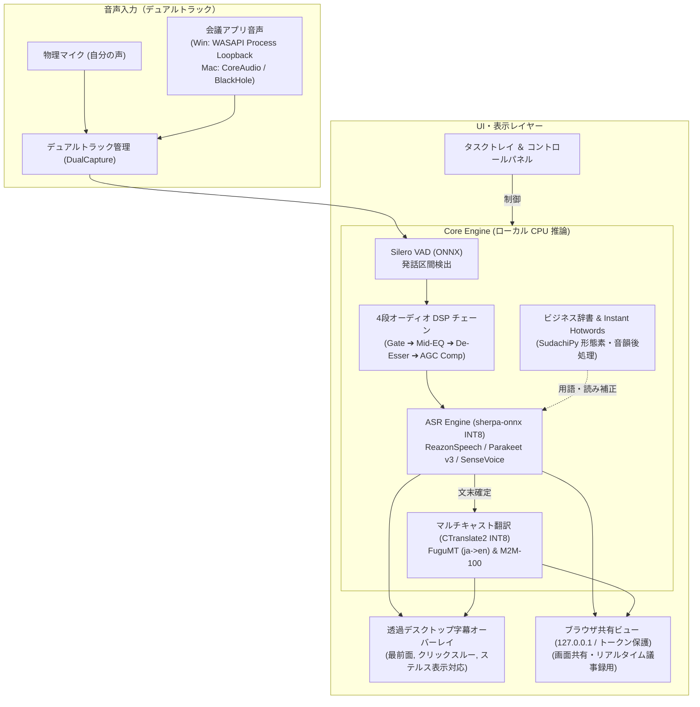

# Hayamimi Polyglot 🎙️🌐

[](https://github.com/oboroge0/hayamimi)
[](https://opensource.org/licenses/Apache-2.0)
[](https://www.python.org/)
[]()

> [!NOTE]
> **Hayamimi Polyglot** は、[oboroge0/hayamimi](https://github.com/oboroge0/hayamimi) をベースに、主要 7 言語（日・英・中・韓・仏・独・西）の音声認識（ASR）、Meta M2M-100 による同時並行翻訳（NMT）、4段オーディオ DSP 前処理チェーン、遅延ロード（オンデマンド起動）、およびクロスプラットフォーム GUI インストーラー等を拡張した派生プロジェクト（Fork）です。

**ローカル動作・低遅延・プライバシー配慮型の多言語ビジネス会議向けリアルタイム同時通訳支援システム**

一般的なビジネスノートPC（Intel Core i5 / AMD Ryzen 5、内蔵GPUのみ、メモリ8〜16GB）の CPU のみで軽快に動作することを目指して設計されています。目標です。
会議中の音声データは外部サーバーへ送信されず、ディスクへの録音ファイル保存も行わないインメモリ設計です。

---

## ⚠️ 重要：免責事項・注意事項（必ずお読みください）

1. **AIによる参考訳の明示**:  
   本ソフトウェアが提供する文字起こしおよび翻訳字幕は、**PCローカルで動作するAIモデルによる自動推論結果（参考訳）** です。正確性・完全性・文脈適合性を保証する公式な通訳ではありません。重要な意思決定、法的拘束力を伴う商談、契約交渉等の場面では、必ず専門の通訳者による確認を行ってください。
2. **ミーティング利用時のエチケット（相手への告知推奨）**:  
   実際のWeb会議（Zoom, Teams, Google Meet等）や対面ミーティングで使用する際は、プライバシーと信頼関係の観点から、**事前に相手側へ「AI字幕・文字起こし支援ツールを利用している旨」を告知し、合意を得て利用することを推奨します**。
3. **オフライン処理の範囲について**:  
   本システムは**「音声入力（ヒアリング） ➔ 音声前処理（DSP） ➔ 音声認識（ASR） ➔ 機械翻訳（NMT） ➔ 字幕表示」の一連のリアルタイム通訳パイプライン処理において外部通信を行いません（ローカル完結）**。  
   ※ 初回セットアップ時のモデルダウンロードや、手動での「モデル追加/更新」実行時を除きます。

---

## ✨ 主な特長

1. **最大5言語の相互並行通訳（マルチキャスト翻訳）**:
   - 会議参加言語（日本語 🇯🇵, 英語 🇺🇸, 中国語 🇨🇳, 韓国語 🇰🇷, 仏語 🇫🇷, 独語 🇩🇪, 西語 🇪🇸）を自由に選択できます。
   - 発言が認識されると、選択された他の言語（最大4言語）へ並行して翻訳され、字幕に同時表示されます。
   - Meta M2M-100 (418M INT8) および FuguMT (日英特化) を内蔵しています。

2. **4段オーディオ DSP 前処理チェーン**:
   - 音声が ASR（音声認識）エンジンに届く前段で、放送音声処理に準じた 4 段階のデジタル信号処理（DSP）をリアルタイムに適用します：
     1. **ソフトニー・ノイズゲート**: 空調音やPCファンなどの定常フロアノイズを減衰。
     2. **中音域イコライザー**: 低域ハムノイズをカットし、子音・母音の明瞭度に関わる中音域（1.8kHz付近）を補強。
     3. **スプリットバンド・ディエッサー**: マイク近接時の歯擦音（サ行・シ音等の高域ピーク）を動的に抑制。
     4. **自動ゲイン制御（AGC）コンプレッサー＆リミッター**: 小さな声や遠いマイクの音声を聞き取りやすいレベルへ均一化し、音割れを防止。

3. **画面共有ステルス表示（字幕や設定画面を画面共有から除外）**:
   - **Windows 11**: `SetWindowDisplayAffinity(WDA_EXCLUDEFROMCAPTURE)`
   - **macOS (12〜15)**: Cocoa API `NSWindow.sharingType = NSWindowSharingNone`
   - 自分の画面には字幕が見える状態で、Zoom / Teams / Meet の画面共有やスクリーンショットから字幕・コントロールパネルを除外するステルス表示に対応しています（設定で共有画面に映すことも可能）。

4. **デュアルトラック音声キャプチャ（自分と相手の音声を分離）**:
   - **Windows 11**: OS標準の **WASAPI Process Loopback** により、追加の仮想ドライバや管理者権限なしで「Zoom.exe」「Teams.exe」等のアプリケーション音声を取得。
   - **macOS**: CoreAudio / BlackHole 2ch 等の仮想オーディオデバイス入力を通じて会議音声を取得。
   - 自分のマイク（Track 1）と相手の音声（Track 2）を別スレッドで並行キャプチャし、話者（「自分」「相手」）を識別します。

5. **Instant Hotwords ＆ ビジネス辞書後処理エンジン**:
   - 会議前にアジェンダや資料テキストを貼り付けると、固有名詞や英字略語を自動抽出（Instant Hotwords）。
   - `SudachiPy`（`SudachiDict-Full`）による形態素解析と音韻（読み）照合により、専門用語や上場企業名、ビジネス略語の表記ゆれを確定後処理で穏やかに補正します。
   - 会議終了時には、一時抽出したホットワードデータをメモリおよび一時ファイルから消去します。

6. **プライバシーとセキュリティ設計**:
   - **録音ファイル非保存**: 音声波形（PCM）はメモリ上のリングバッファで処理後に破棄され、ディスクへ録音ファイルを保存しません。
   - **ローカルホスト限定＆トークン保護**: 内部Webサーバー（ブラウザ共有ビュー）は `127.0.0.1` にのみバインドし、起動ごとに生成されるワンタイムトークンと同一オリジン検証により外部サイトからの不正アクセスを防止します。
   - **商用利用可能なライセンス構成**: 非商用制限（CC-BY-NC等）のあるモデルを除外し、商用利用が許諾されたモデル・ライブラリで構成しています。

---

## 🏗️ システムアーキテクチャ



---

## 🚀 クイックスタート & インストール

### 1. ワンライナーセットアップ (管理者権限不要)
PowerShell または ターミナルを開き、以下のコマンドを実行すると GUI インストーラーが起動します。  
（※ ドキュメントフォルダが OneDrive や iCloud Drive の管理下にある場合は、クラウド同期の負荷を避けるためユーザーホーム直下の `~/hayamimi-polyglot` が既定のインストール先として提案されます。アンインストール時はそのフォルダを削除するだけで完結します。）

#### Windows 11 (PowerShell)
```powershell
irm https://raw.githubusercontent.com/Maximilian2022/hayamimi-polyglot/main/setup.ps1 | iex
```

#### macOS (12〜15)
```bash
curl -fsSL https://raw.githubusercontent.com/Maximilian2022/hayamimi-polyglot/main/setup.sh | bash
```

---

### 2. ポータブル版（ZIP 配布）の利用

GitHub Releases からダウンロードしたポータブル ZIP を解凍して直接利用することも可能です。

#### Windows 11 でのご利用にあたって（Smart App Control / SmartScreen への配慮）
Windows 11 の Smart App Control（スマート アプリ コントロール）または SmartScreen が有効な環境では、Web ブラウザ経由でダウンロードした ZIP ファイルに「Mark of the Web（MOTW）」と呼ばれるセキュリティ識別子が付与され、起動時に警告が表示される場合があります。

スムーズにご利用いただくため、以下の手順をおすすめいたします：
1. ダウンロードした ZIP ファイル（`hayamimi-polyglot-vX.X.X-windows-portable.zip`）を右クリックし、**「プロパティ」** を開きます。
2. 全般タブの下部にある **「セキュリティ: 許可する (Unblock)」** にチェックを入れ、**「OK」** をクリックします。
3. その後、ZIP ファイルを任意のフォルダ（デスクトップやユーザーホーム等）に展開し、`start.bat` をダブルクリックして起動してください。

> [!TIP]
> 上記のワンライナーセットアップ（PowerShell `irm ... | iex`）をご利用いただく場合は、システム上で直接安全に環境が構築されるため、この確認操作は不要です。

---

### 3. インストール後の起動

#### Windows 11
```cmd
start.bat
```

#### macOS
```bash
chmod +x start.sh
./start.sh
```
（または Finder から `Hayamimi Polyglot.command` をダブルクリックして起動できます）

ブラウザで議事録・画面共有用ビューを開く場合は、コントロールパネルの **「🌐 ブラウザ共有画面」** ボタンをクリックしてください（認証トークン付きのローカルURLが開きます）。

---

## 📄 ライセンス & 謝辞 (Credits)

- **ベースプロジェクト**: [oboroge0/hayamimi](https://github.com/oboroge0/hayamimi) (MIT License) - 原案・基礎設計に深く感謝いたします。
- **Hayamimi Polyglot**: 本プロジェクトは [Apache License 2.0](LICENSE) の下で公開されています。
- **サードパーティライセンス表示**: 使用しているモデル・ライブラリ・オープンデータのライセンス条文および著作権表示は [Third_Party_Notices.md](Third_Party_Notices.md) をご確認ください。

---

## 🤝 コミュニティ & ガイドライン

- [行動規範 (Code of Conduct)](.github/CODE_OF_CONDUCT.md)
- [貢献ガイドライン (Contributing Guide)](.github/CONTRIBUTING.md)
- [セキュリティポリシー (Security Policy)](.github/SECURITY.md)
- [第三者ライセンス通知 (Third Party Notices)](Third_Party_Notices.md)
- [言語・モデル相関仕様書](docs/languages.md)
