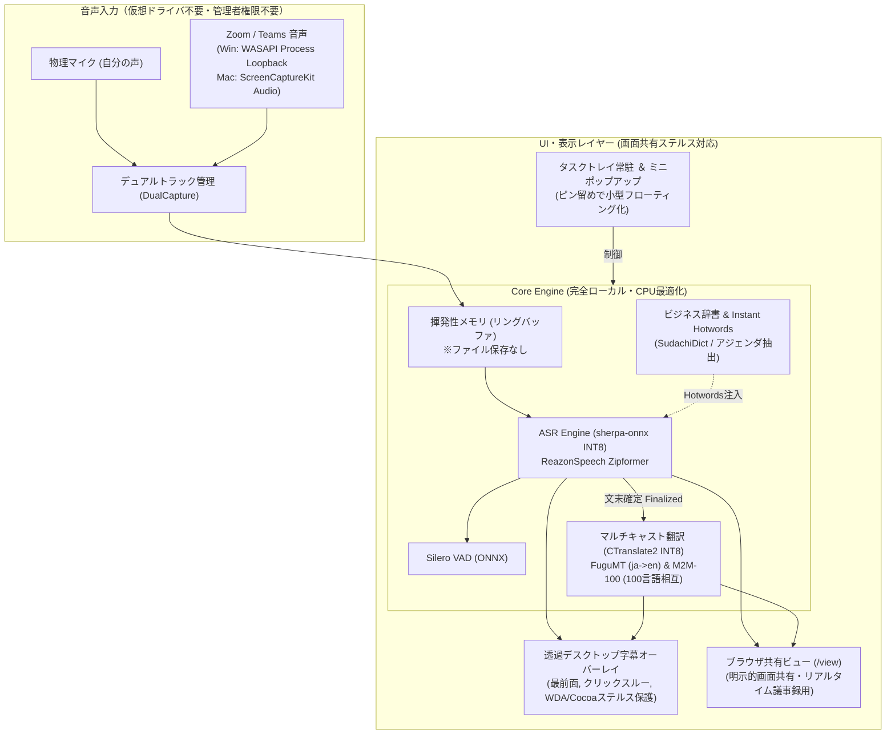

# Hayamimi Polyglot 🎙️🌐

**完全ローカル・低遅延・高セキュリティな多言語ビジネス会議向けリアルタイム同時並行通訳システム**

3〜5年前の一般的なビジネスノートPC（Intel Core i5 / Ryzen 5、内蔵GPUのみ、メモリ8〜16GB）のCPUのみで軽快に動作します。  
音声データは外部クラウドへ一切送信されず、ディスクへの録音ファイル保存もゼロ。社内コンプライアンス審査を100%クリアする安全設計です。

---

## ✨ 主な特長

1. **最大5言語の相互並行通訳（マルチキャスト翻訳）**:
   - 会議参加言語（日本語 🇯🇵, 英語 🇺🇸, 中国語 🇨🇳, 韓国語 🇰🇷, 仏語 🇫🇷, 独語 🇩🇪, 西語 🇪🇸, 越語 🇻🇳）を自由に選択。
   - 誰かが発言すると、**自動的に選択された他の全言語（最大4言語）へ並列翻訳**され、字幕に同時表示されます。
   - 追加ダウンロードなしで100言語以上の相互双方向翻訳が可能です（Meta M2M-100 418M INT8 & FuguMT 内蔵）。

2. **画面共有ステルス保護（カンペ・翻訳が相手に見えない）**:
   - **Windows 11**: `SetWindowDisplayAffinity(WDA_EXCLUDEFROMCAPTURE)`
   - **macOS (12〜15)**: Cocoa API `NSWindow.sharingType = NSWindowSharingNone`
   - **「自分には字幕が見えるが、Zoom/Teams/Meetの画面共有やスクリーンショットには一切映らない」** ステルス表示を標準搭載（オプションで相手に見せることも可能）。

3. **仮想ミキサー不要の直デバイス・デュアルトラックキャプチャ**:
   - 外部ドライバ（VB-CABLE等）や管理者権限（UAC）は不要。
   - OS標準の **WASAPI Process Loopback** / **ScreenCaptureKit** により、「Zoom.exe」「Teams.exe」の音声だけをピンポイント取得。
   - 自分のマイク（Track 1）と相手の音声（Track 2）を別スレッドで並行キャプチャし、**計算負荷ゼロで発言者を100%完全分離**。

4. **Instant Hotwords ＆ クリーンビジネス辞書**:
   - 会議直前にアジェンダやスライドテキストをコピペするだけで、固有名詞・プロジェクトコード・略語を自動抽出し、ASR認識精度を即時ブースト。
   - `SudachiDict (Full)` (Apache 2.0) ＋ 金融庁EDINET上場企業名オープンデータを標準内包。

5. **企業導入のためのセキュリティ7原則（Zero Telemetry）**:
   - **音声ゼロトレース**: 音声波形（PCM）のディスク保存機能は完全排除。メモリ上でASR処理後即破棄。
   - **外部通信ゼロ**: テレメトリ、外部CDN、クラウドAPIへの通信は1バイトも行いません。
   - **自マシン限定バインド**: 内部Webサーバーは `127.0.0.1:8844` のみに厳格バインド（LAN内盗聴・DNS Rebinding遮断）。
   - **ログ平文保護**: 運用ログに顧客の会話内容を出力しません。
   - **DOM XSS対策**: ブラウザビューでの安全なサニタイズ描画。
   - **クリーンライセンス保証**: 全コンポーネントを商用フリー（Apache 2.0 / MIT）で統一。

---

## 🏗️ システムアーキテクチャ



---

## 🚀 クイックスタート

### Windows 11
```cmd
start.bat
```

### macOS
```bash
chmod +x start.sh
./start.sh
```

ブラウザで議事録・画面共有用ビューを開く場合は、`http://127.0.0.1:8844/view` にアクセスしてください。

---

## 📄 ライセンス

本プロジェクトは [Apache License 2.0](LICENSE) の下で公開されています。商用利用・企業内利用が完全に許諾されています。

